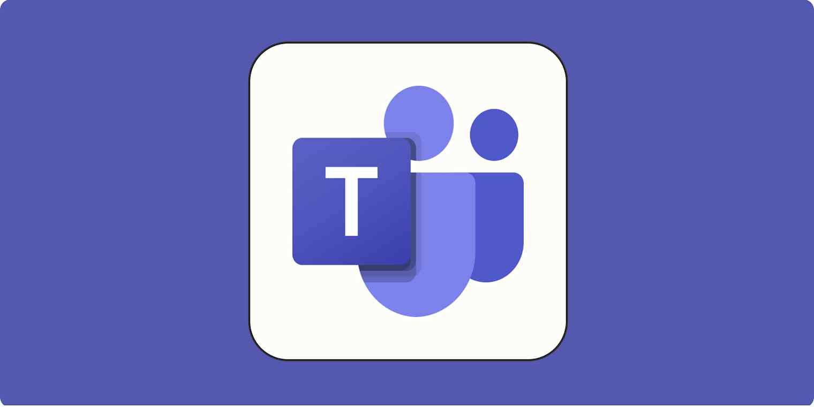

{: .align-center width="600px"}

I like to think that I keep up with cybersecurity news as best as I can. I read articles and blog posts when I have time, as well as listen to podcasts about current events in the cyber world when I drive or work. I think it goes without saying that there has been a lot of doom and gloom surrounding topics regarding AI recently. It is always fascinating to see artificial intelligence advance in ways that really help society, but the amount of times that it is used as a tool for threat actors makes its existence so much more anxiety inducing. In this hectic storm of fear mongering and actual threats, I find it best to reconnect with reality and take breaks in an attempt to not overwhelm myself with these headlines of impending doom. One of the ways that I try to reconnect with the world is to spend time with loved ones. This past weekend, I was able to spend some time with my family over dinner. We all chatted about a variety of things; work, upcoming holidays, family that was not in attendance, and so on. Eventually, my mind came back to the very thing I was trying to take my mind off of during our discussions. My grandma had brought up a series of phone calls that she had been receiving. The calls had all been individuals posing to be various individuals, claiming to be a family member or a member of her bank asking for specific information about her bank info or login credentials. Thankfully, my grandma is able to see through these lies better than most and was able to find out their true intentions rather quickly. During this story, I immediately recognized these phone calls as phishing attacks. When you have been on the internet long enough, I feel like it becomes easier to discern these kinds of malicious attempts, but when it comes to someone uninformed, it can leave individuals vulnerable. I recall an activity I did during the CompTIA Network+ coursework where I was tasked with deleting emails that were related to phishing, and as confident as I was, it proved to be more difficult than initially anticipated. 

After my evening of cooldown from the news, I was surprised to see something that I had been thinking about during my offtime in the world of cyberthreats. Microsoft Teams is incorporating AI Teams chat monitoring to parse conversations and detect impersonation in an attempt to prevent phishing attacks. This solution spawned out of the recurring problem that Microsoft Teams had had with phishing attacks in the past. Historically, threat actors would contact unknowing employees of various companies posing as IT or system admins. They would send messages describing updates or changes to their certifications. All the employee would have to do is click the link or follow the steps and the system could be exploited in whichever way the threat actor pleased. Even with training to detect malicious attackers in phishing attacks, these can be hard to detect. Now, with Microsoft Teams' new solution to this problem, conversations taking place on Teams will be monitored by an AI that is on the lookout for any attempt of social engineering to any degree. When it detects a potentially malicious message, the AI will notify the user to be cautious about the sender's supposed identity or what they might be asking. Additionally, Microsoft announced that the information the AI reads in Teams chats are private and will not be used for future AI learning models. This demonstrates an idea that this new feature is for the safety of the companies and employees Teams hosts. 

Personally, I think this is a major step in the right direction and a perfect example of using AI for good. I cannot overstate how difficult phishing attempts can be to detect, especially when it targets individuals that aren't as familiar with the attack type. With the implementation of this AI, potential attacks directed at companies should dramatically decrease. In the future, I would love to see other platforms adopt this method to evade cyber attacks. Additionally, I think it would be beneficial to implement this protection over phone calls and other mediums, as there are more than one way that phishing occurs.

Getting back into the news and seeing something good has made me inspired for the future, allowing me to temporarily forget about the feeling of impending doom that likes to linger in the world of cybersecurity. I’m curious what others think of this. Do you think this is a step in the right direction? Does having AI parse through work chats seem like a potential security risk? As always, feel free to reach out and let me know what you think. Until then, I hope everyone has a great week. See you later!
